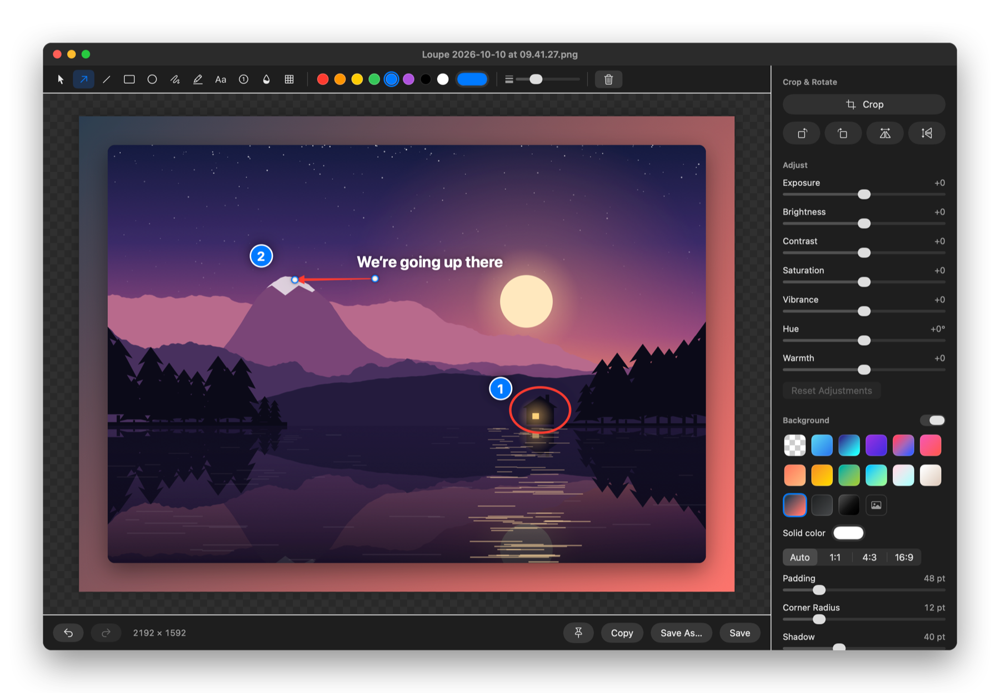

<p align="center">
  
</p>

<h1 align="center">Loupe</h1>

<p align="center">A fast, native screenshot tool for macOS: capture, mark up, and polish screenshots in seconds.</p>

<p align="center"><a href="https://loupe.pics"><strong>Download at loupe.pics</strong></a></p>

<p align="center"></p>

## Features

- **Capture** an area, a single window (click it), or the full screen. You can adjust the selection before
  capturing, re-capture the previous area, or use a self-timer for menus.
- **Mark up** with arrows, lines, shapes, text, highlighter, numbered steps, blur and pixelate.
- **Polish** with gradient or image backgrounds, padding, rounded corners and shadows. Crop, rotate, and
  adjust exposure, contrast, saturation and hue.
- **Share**: a quick-access thumbnail after every capture (copy, save, edit, drag), capture history, and
  screenshots pinned above other windows.

| Shortcut | Action |
| --- | --- |
| <kbd>⌥⇧4</kbd> | Capture area (or click a window) |
| <kbd>⌥⇧5</kbd> | Capture area, adjust, then capture |
| <kbd>⌥⇧3</kbd> | Capture fullscreen |
| <kbd>⌥⇧6</kbd> | Capture previous area |
| <kbd>⌥⇧7</kbd> | Capture with self-timer |

All shortcuts can be changed in Settings. Requires macOS 14 Sonoma or later (Apple Silicon or Intel).

## Install

Download from **[loupe.pics](https://loupe.pics)** and drag Loupe into Applications. See [INSTALL.md](INSTALL.md) for first-launch
and Screen Recording permission steps.

## Build from source

Needs only the Xcode Command Line Tools.

```bash
scripts/build-app.sh          # builds build/Loupe.app (universal)
open build/Loupe.app
```

`Loupe --edit image.png` opens an image straight in the editor.

## Release

```bash
scripts/release.sh 1.0.1
```

On an up-to-date, clean `main`, this builds and signs `dist/Loupe-1.0.1.dmg`, signs it for Sparkle
updates, publishes GitHub Release `v1.0.1` with the DMG, writes the site into `web/` (page,
`appcast.xml`, `vercel.json`) and pushes. The Vercel project deploys `web/` to
[loupe.pics](https://loupe.pics) whenever a push changes it, and installed copies update from
`loupe.pics/appcast.xml`. Release notes come from `release-notes/<version>.html`. Use
`--no-publish` to build and preview without publishing; `scripts/deploy-site.sh` redeploys `web/`
manually. With a Developer ID certificate and a `loupe-notary` notarytool profile, releases are
also notarized (see [scripts/release.sh](scripts/release.sh)).

`swift scripts/make-icon.swift Resources/AppIcon.icns` regenerates the icon,
`swift scripts/make-og-image.swift` the social preview image (`site/og-image.png`), and
`scripts/make-screenshot.sh` the editor screenshot (`site/editor.png`) from the real UI.

## Project layout

| Path | Contents |
| --- | --- |
| `Sources/Loupe/App` | App delegate, menu bar item, settings |
| `Sources/Loupe/Capture` | ScreenCaptureKit capture, selection overlay, self-timer |
| `Sources/Loupe/Editor` | Editor, Core Image pipeline, annotations, backgrounds |
| `Sources/Loupe/QuickAccess`, `History`, `Pin` | Post-capture thumbnail, history, pinned screenshots |
| `Sources/Loupe/Support` | Hot keys, shortcuts, preferences, export |
| `site/` | Landing page template and assets |
| `web/` | The deployed site (generated by `release.sh`) |

## License

[MIT](LICENSE)
